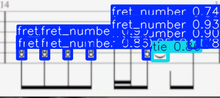
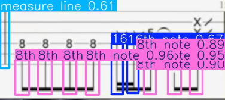
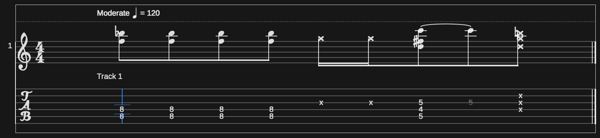

an automatic guitar tab transcription tool that converts images of guitar tablature into editable, playable XML files — training a YOLOv8 computer vision model from scratch to detect and interpret tab notation directly from images. Used OpenCV and EasyOCR to analyze the image and obtain information such as line numbers and fret numbers, and designed the pipeline that converts the images to the xml file.

The model reading the notes

The model reading the rhythm

Rhtyhmic stems not shown only due to the system of the music notation.